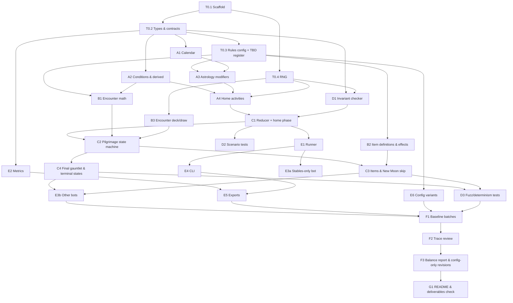

# The Hidden Scion — Phase 0 Implementation Task Breakdown

**Derived from:** [thematic-design-doc.md](thematic-design-doc.md) and [technical-planning-doc.md](technical-planning-doc.md) (where these conflict, the technical doc wins unless noted under §5 Open questions).
**Scope:** Phase 0 only: the headless rules engine, tests, bots, batch simulation, and baseline balance report. Phase 1 (browser PoC) gets a short outline at the end.
**Location:** Build the TypeScript project at the repo root (`package.json` name `hidden-scion`) and use the layout from tech doc §14. The repo isn't under git yet, so run `git init` before T0.1.

---

## 0. How to read this document

Each task has:

- **ID**: `<workstream><number>`, for example `C2`.
- **Depends on**: tasks that must be *merged* before this one can start. A *soft* dependency means you can start against the agreed interface (types/stubs) and integrate once the other task lands.
- **Parallel with**: tasks that can safely run at the same time. They touch different files or only share frozen interfaces.
- **Deliverables / Acceptance**: what "done" means. Every task includes its own unit tests unless it says otherwise.

**The key to parallelism is T0.2 (types and interface contracts).** Once the types, the action/event unions, and the modifier-pipeline contract are frozen, nearly every rules module, the test harness, and the metrics code can be written in parallel.

### Milestones

| Milestone | Contents | Unlocks |
|---|---|---|
| **M0 Foundation** | T0.x: scaffold, types, config, RNG | All workstreams |
| **M1 Home loop** | A1–A4, C1 | Stables-only bot, home-only trace runs |
| **M2 Pilgrimage complete** | B1–B4, C2–C4 | All bots, full campaigns |
| **M3 Simulation** | E1–E6 | Batch runs and reports |
| **M4 Baseline balance** | F1–F3 | Phase 1 go/no-go |

---

## 1. Dependency graph

### Suggested lanes (3–4 parallel developers or agents)

| Lane | Focus | Sequence |
|---|---|---|
| **Lane 1: Home rules** | A-series, then reducer | A1 → A2 → A3 → A4 → C1 → C4 |
| **Lane 2: Pilgrimage** | B-series, then pilgrimage FSM | B1 → B3 → B2 → C2 → C3 |
| **Lane 3: Quality** | Invariants and tests | D1 → D2 (TDD against C1/C2 as they land) → D3 |
| **Lane 4: Simulation** | Metrics, runner, bots | E2 → E6 → E1 → E4 → E3a → E5 → E3b → F-series |

Everyone works on M0 together or in order (T0.1 → T0.2 + T0.4 → T0.3). T0.2 should be reviewed by every lane owner before it's frozen.

---

## 2. Completed workstreams (T0, A, B, C, D)

These are done and merged. Their full task specs, contract notes and decisions are archived in [archive/implementation-tasks-phase0-core.md](archive/implementation-tasks-phase0-core.md); read that file for the exact engine contracts the E-series builds on.

- **T0 Foundation (M0).** TypeScript ESM scaffold with Vitest and a core-purity test; the frozen types and action/event unions in `src/core/types.ts`; `RulesConfig` with provenance, `getUnresolved`, `hashConfig` and variant merging (`src/core/config.ts`, `content/`); and a pure Mulberry32 RNG with named `jobs`/`encounters`/`rewards` substreams (`src/core/rng.ts`). All multipliers are integer percents, floored once.
- **A Home rules (M1).** Calendar, birthdays and lunar/solar phases (`calendar.ts`); burden ceilings, Purse Protection and derived stats (`conditions.ts`, `derived.ts`); astrology modifiers and critical-period reminders (`astrology.ts`); and tutor/job/rest resolution that checks affordability before any RNG draw (`economy.ts`).
- **B Pilgrimage building blocks.** Encounter odds, matchups, road bonuses and failure penalties (`encounter.ts`); data-driven items with probability/penalty hooks and consumable stage rules (`items.ts`, `content/items.json`); and the seeded, non-adaptive threat draw (`drawThreat` in `pilgrimage.ts`).
- **C Reducer and state machine (M2).** The public API in `src/core/index.ts`: `createCampaign`, `getAvailableActions` and an atomic, non-mutating `applyAction`. Home weeks with forced convalescence (`reducer.ts`); the pilgrimage FSM with Coin accounting, retreat and wipeout (`pilgrimage.ts`); slot items, Metheglin rerolls and the New Moon skip; and the final gauntlet with victory/deadline terminal states.
- **D Quality and test harness.** The invariant checker (`src/tests/invariants.ts`, usable by the runner in `--strict` mode); deterministic §13 scenarios with the `scenario()`/`forcedRolls()` harness (`src/tests/scenarios/`); and 1,000-campaign fuzzing with byte-identical replay and atomic-rejection probes (`src/tests/fuzz/`). Note for E2: a Metheglin reroll emits a second `encounter_resolved` for the same encounter, and consumed or lost items emit `item_changed` with amount 0.

---

## 3. Workstream E: Simulation

### E1 Runner
- **Depends on:** C1 (home-only at first; it gains pilgrimage support automatically once C2 lands). **Parallel with:** C2–C4, E2.
- **File:** `src/simulation/runner.ts`.
- **Work:**
  - `runCampaign({seed, sign, policy, config, trace?}) → {finalState, events, decisions}`.
  - The loop asks the policy for an action from `getAvailableActions`, applies it, and records the decision with its pre-roll probability.
  - A safety cap on steps.
  - Optional `assertInvariants` in strict mode.
  - Seed derivation for batches: `seed = hash(baseSeed, sign, runIndex)`, independent of the policy, so policies are compared on paired seeds.

### E2 Metrics — completed

Implemented in `src/simulation/metrics.ts`, with synthetic event-stream and engine consistency tests in `src/tests/metrics.test.ts`. The completed task specification is archived in [archive/implementation-tasks-phase0-metrics.md](archive/implementation-tasks-phase0-metrics.md). E5 can consume `runRecord` and the policy × sign aggregates.

### E3 Policy bots — completed

E3a and E3b are implemented in `src/simulation/policies.ts`: Stables-only, B/O/L specialists, Balanced, Reckless and Pragmatic. The factories expose validated params and stable policy IDs for E4. Tests in `src/tests/policies.test.ts` include 20 seeded campaigns per bot with strict invariants and decision-trace replay. See [archive/implementation-tasks-phase0-policies.md](archive/implementation-tasks-phase0-policies.md) for the completed specification and README for usage and heuristic assumptions.

### E4 CLI
- **Depends on:** E1. **Parallel with:** E3, E5.
- **File:** `src/simulation/cli.ts`.
- **Work:** use `node:util` `parseArgs`. Flags: `--policy`, `--all-policies`, `--birth-sign`, `--all-signs`, `--runs`, `--seed`, `--trace`, `--trace-seed`, `--config`, `--variant`, `--out`, `--strict`, `--weeks` (sensitivity only). `--trace` prints a readable week-by-week log: activity, probability, roll, deltas, and aspects.
- **Acceptance:** the two commands in tech §14 work exactly as written.

### E5 Report exports
- **Depends on:** E2, E4. **Parallel with:** E3b.
- **File:** `src/simulation/report.ts`.
- **Work:** write `runs.csv`, `summary.json` (with config hash, full config snapshot, unresolved-parameter list, git commit if available, and CLI args), `summary.md` (tables per policy × sign, flagged anomalies, and a "partial astrology" label when TBD astrology values are off), and `events.ndjson` for `--trace-seed` runs.
- **Acceptance:** a golden-file test on a 5-run batch with a fixed seed.

### E6 Configuration variants
- **Depends on:** T0.3. **Parallel with:** nearly everything.
- **Files:** `content/variants/*.json`.
- **Work:** named variants for route length 4, 5, and 6; flat versus steep road bonus curves; final N of 6, 8, and 10 and final road bonus of −10, −20, and −30; `items-test-table`; `astrology-full` (enables the TBD lunar bonuses with candidate values); and `weeks-48`.
- **Acceptance:** all variants validate and their hashes differ.

---

## 4. Workstream F/G: Balance and wrap-up (M4)

### F1 Baseline batches
- **Depends on:** E3b, E5, E6, D3.
- **Work:** 1,000 runs × each policy (7 including B/O/L specialists) × 12 signs on `rules.experimental.json`, then the variant sweeps. Rerun at 5,000 only where comparisons are close. This is about 84k campaigns per config, so check the runtime and consider `worker_threads` in the runner if one config takes over ~2 min.

### F2 Trace review
- **Depends on:** F1. Pull `--trace-seed` traces for outliers: the fastest wins, deadline failures with high stats, wipeout spirals, and zero-treasury loops. Check for degenerate strategies, such as Stables-plus-Rest being optimal or one Estate dominating.

### F3 Baseline balance report
- **Depends on:** F2. Write `docs/balance-report-baseline.md` covering findings, defects, hypotheses, and **config-only** proposed changes, with before/after numbers. Rule-logic changes go to the open-questions list for approval and are not made silently.

### G1 README and deliverables checklist
- **Depends on:** F3 (it can be drafted earlier, in parallel). Write a README with exact commands, an architecture overview, and a link to the unresolved-parameter register, and tick off the tech doc §16 checklist.

---

## 5. Open questions found while planning

Every task above already has a configurable default for these, so **none of them block implementation**, but they should be answered before F3 draws conclusions.

| # | Question | Source conflict | Default used | Affects |
|---|---|---|---|---|
| Q1 | Tutor burden mapping | Unspecified | HK +5F, Hermit +5M, Smuggler +5F/+5M | A4, A3 |
| Q2 | Does Purse Protection also reduce Coin lost on failed **Laboratores encounters**? | Thematic §2 says yes; tech §7 applies it only on wipeout | Wipeout only (flag) | B1, C2 |
| Q3 | New Moon skip: once per **route** or once per **segment**? | Thematic §4 says "per route"; tech §6 says "per segment" | Per segment, feature off | C3 |
| Q4 | Waxing: compounding streak or one-time ×1.1? | Thematic says "compounding"; tech says once | Once (`mode: 'single'`) | A3 |
| Q5 | Square month with a tutor that generates no Melancholy (Hedge Knight under Q1's default) has no downside. Intended? | Interaction of Q1 with Square | As configured | A3, balance |
| Q6 | Order of Full Moon ×2 and Gambeson −5 | Unspecified | Double first, then −5 (25) | B1 |
| Q7 | Is the retreat toll paid from carried Coin or the treasury? If carried Coin can't cover it? | Tech §10 lists it as unconfirmed | Carried first, remainder from treasury, floor 0 | C2 |
| Q8 | Can Theriac/Wort be used at a waystation, or only between encounters? | Unspecified | Both | B2, C3 |
| Q9 | Is the New Moon skip fee paid from carried Coin? Does a skipped card count as "survived"? | Unspecified | Carried; counts toward N | C3 |
| Q10 | Saint's Relic: +10 probability (helps) vs +10 to the die (hurts under roll-under) | Thematic wording ambiguous | +10 probability | B1 |
| Q11 | Do Opposition's ×1.5 burdens apply to job *failure* burdens too? | "Job-generated" is ambiguous | Yes, both | A3 |
| Q12 | Do Full Moon "surge" and New Moon "bonus" for home activities have values? | Unspecified | 0 (off) and report labeled "partial astrology" | A3, E5 |
| Q13 | Post-wipeout burden recovery and home-collapse forced week | Unspecified | Reset to 0; forced week with −15/−15 | C1, C2 |

---

## 6. Phase 1 preview (not part of this breakdown)

Once M4 is accepted, the browser PoC (React + Vite) consumes `src/core` unchanged. The likely parallel streams are:

1. App shell, state store wrapping `applyAction`, and save/load (JSON + localStorage).
2. Scheduling screen with the calendar and solar/lunar indicators and critical-period reminders.
3. Stat panel with condition bars that show the reduced ceiling as a greyed section.
4. Pilgrimage encounter card UI with rubricated borders, approach selection, and item slots.
5. Opening storyboard and initial setup (names and sign).
6. Art, typography, and audio.

These depend only on the frozen core API, so they can proceed largely in parallel. Plan them in detail after the baseline balance report.
