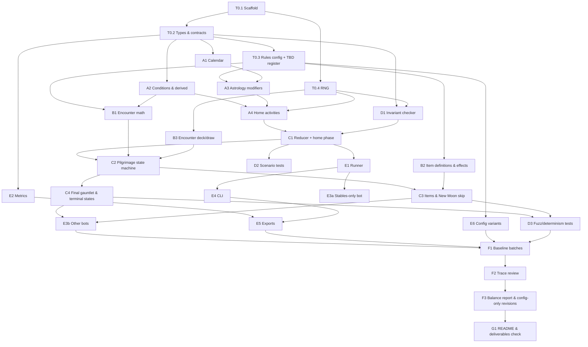

# The Hidden Scion — Phase 0 Implementation Task Breakdown

**Derived from:** [thematic-design-doc.md](thematic-design-doc.md) and [technical-planning-doc.md](technical-planning-doc.md) (where these conflict, the technical doc wins unless noted under §9 Open Questions).
**Scope:** Phase 0 only: the headless rules engine, tests, bots, batch simulation, and baseline balance report. Phase 1 (browser PoC) gets a short outline at the end.
**Location:** Build the TypeScript project at the repo root (`package.json` name `hidden-scion`) and use the layout from tech doc §14. The repo isn't under git yet, so run `git init` before T0.1.

---

## 0. How to read this document

Each task has:

- **ID**: `<workstream><number>`, for example `C2`.
- **Depends on**: tasks that must be *merged* before this one can start. A *soft* dependency means you can start against the agreed interface (types/stubs) and integrate once the other task lands.
- **Parallel with**: tasks that can safely run at the same time. They touch different files or only share frozen interfaces.
- **Deliverables / Acceptance**: what "done" means. Every task includes its own unit tests unless it says otherwise.

**The key to parallelism is T0.2 (types and interface contracts).** Once the types, the action/event unions, and the modifier-pipeline contract are frozen, nearly every rules module, the test harness, and the metrics code can be written in parallel.

### Milestones

| Milestone | Contents | Unlocks |
|---|---|---|
| **M0 Foundation** | T0.x: scaffold, types, config, RNG | All workstreams |
| **M1 Home loop** | A1–A4, C1 | Stables-only bot, home-only trace runs |
| **M2 Pilgrimage complete** | B1–B4, C2–C4 | All bots, full campaigns |
| **M3 Simulation** | E1–E6 | Batch runs and reports |
| **M4 Baseline balance** | F1–F3 | Phase 1 go/no-go |

---

## 1. Dependency graph



### Suggested lanes (3–4 parallel developers or agents)

| Lane | Focus | Sequence |
|---|---|---|
| **Lane 1: Home rules** | A-series, then reducer | A1 → A2 → A3 → A4 → C1 → C4 |
| **Lane 2: Pilgrimage** | B-series, then pilgrimage FSM | B1 → B3 → B2 → C2 → C3 |
| **Lane 3: Quality** | Invariants and tests | D1 → D2 (TDD against C1/C2 as they land) → D3 |
| **Lane 4: Simulation** | Metrics, runner, bots | E2 → E6 → E1 → E4 → E3a → E5 → E3b → F-series |

Everyone works on M0 together or in order (T0.1 → T0.2 + T0.4 → T0.3). T0.2 should be reviewed by every lane owner before it's frozen.

---

## 2. Workstream T0: Foundation (M0)

### T0.1 Project scaffold
- **Depends on:** none. **Parallel with:** nothing (very short).
- **Files:** `package.json`, `package-lock.json`, `tsconfig.json`, `vitest.config.ts`, `.gitignore`, `src/core/`, `src/simulation/`, `src/tests/`, `content/`.
- **Work:**
  - Node 20+, TypeScript `strict: true`, `noUncheckedIndexedAccess: true`, ESM.
  - Scripts: `test`, `test:watch`, `typecheck`, `sim` (via `tsx src/simulation/cli.ts`), `lint` (optional).
  - Add `reports/` to `.gitignore`.
  - Enforce the core-purity rule (tech §1 AC7): an ESLint `no-restricted-imports` rule, or a test that greps `src/core/**` for `react`, `zustand`, `node:`, `fs`, `path`, `process`, `Math.random`, and `Date.now`.
- **Acceptance:** `npm test` and `npm run typecheck` pass on an empty suite, and the purity check fails if a forbidden import is added.

### T0.2 Types and interface contracts ⚠️ *critical path; freeze after review*
- **Depends on:** T0.1. **Parallel with:** T0.4.
- **File:** `src/core/types.ts`.
- **Work:**
  - `Estate`, `Phase`, `PilgrimageStage`, `ZodiacSign` (12 literal members), `ActivityId` (string-literal union: `hedge_knight | hermit | smuggler | stables | alehouse | village_watch | scriptorium | rest_home | bathhouse | shrine | banquet`).
  - `CampaignState` from tech §9, extended with:
    - `playerName: {first, last}` and `scionName`, from the thematic doc's initial setup. These are cheap identifiers with no rules effect.
    - `pilgrimage.skipUsed: boolean` (New Moon skip), `pilgrimage.consumableUsed: boolean`, `pilgrimage.isFinal: boolean`, `pilgrimage.segmentEntryWeek` (locks the lunar phase for the segment).
    - `waxingStreak: number`, if compounding Waxing is ever enabled (see §9 Q4).
    - `pendingConvalescence?: 'home_collapse' | 'wipeout'`, so convalescence weeks are resolved explicitly.
  - `GameAction` tagged union: `TRAIN{tutor}`, `WORK{job}`, `REST{rest}`, `BEGIN_PILGRIMAGE{carry, equipmentId?, consumableId?}`, `CHOOSE_APPROACH{estate}`, `SKIP_ENCOUNTER` (New Moon bribe; **not in tech §9's list, but required by §6**), `USE_CONSUMABLE{itemId}`, `ACCEPT_RESULT`, `CONTINUE_ENCOUNTER`, `RETREAT`, `RETURN_HOME`, `CONTINUE_SEGMENT`.
  - `GameEvent` tagged union: `week_spent`, `stat_changed`, `burden_changed`, `coin_changed{account: 'treasury'|'carried', source}`, `job_resolved{success, probability, roll}`, `collapse{cause}`, `convalescence`, `pilgrimage_started`, `encounter_drawn`, `encounter_skipped`, `encounter_resolved`, `reroll_used`, `consumable_used`, `waystation_reached`, `retreat`, `wipeout{cause}`, `victory`, `deadline`. Every event carries `week`. Coin events carry a `source` tag so metrics can attribute earnings, spending, and losses (tech §12).
  - `RuleError` typed errors (`INVALID_PHASE`, `INSUFFICIENT_FUNDS`, `INVALID_ITEM`, `DEADLINE_REACHED`, …).
  - **Modifier-pipeline contract** (lets A3, A4, and B1 be built in parallel):
    ```ts
    interface ModifierContext { activityId: ActivityId; kind: 'tutor'|'job'|'rest';
      solar: SolarAspect; lunar: LunarPhase; previousActivityId?: ActivityId; }
    interface ModifierSet {            // all multipliers as integer percents (100 = ×1.0)
      successBonusPts: number;
      statGainPct: number; payoutPct: number; costPct: number;
      fatiguePct: number; melancholyPct: number; recoveryPct: number;
      sources: string[];               // e.g. ['solar:square', 'lunar:waxing'] for traces
    }
    ```
  - **Integer-math rule:** store multipliers as integer percentages and compute `floor(base * p1 * p2 … / 100^n)` in integer arithmetic. This guarantees "floor once" with no float drift (for example, `1.1 * 10` in IEEE floats is `11.000000000000002`).
  - `DerivedStats`, `CalendarInfo`, and the signatures of `createCampaign`, `getAvailableActions`, `applyAction`, `getDerivedStats`, `getCalendar`.
- **Acceptance:** compiles, and every lane owner has signed off. After the freeze, changes need a short note in the PR so other lanes can adapt.

### T0.3 Rules configuration and unresolved-parameter register
- **Depends on:** T0.2. **Parallel with:** T0.4, A1, A2, D1.
- **Files:** `src/core/config.ts`, `content/rules.default.json`, `content/rules.experimental.json`, `content/items.json`, `docs/unresolved-parameters.md` (generated or hand-kept).
- **Work:**
  - Typed `RulesConfig` with sections `calendar`, `startingState`, `classes`, `jobs`, `rest`, `astrology`, `encounters`, `route`, `failure`, `items`.
  - Every value that is not confirmed carries metadata `{ value, status: 'confirmed' | 'experimental' | 'tbd', note }`, or the same thing in a parallel `provenance` map. `getUnresolved(config)` lists all non-confirmed entries for report metadata.
  - Experimental defaults, taken from the tech doc:

    | Key | Default | Status |
    |---|---|---|
    | `route.regularSegments` / `encountersPerSegment` / `finalEncounters` | 5 / 5 / 8 | experimental |
    | `route.roadBonus` | [40,30,20,10,0] | confirmed shape |
    | `route.finalRoadBonus` | −20 | experimental |
    | `classes.tutorBurden` | HK +5F, Hermit +5M, Smuggler +5F+5M | tbd |
    | `astrology.newMoon.activityBonus` / `fullMoon.surge` | 0 (off) | tbd |
    | `astrology.newMoon.skipFee` | off | tbd |
    | `astrology.waxing.mode` | `'single'` | tbd |
    | `astrology.waning.appliesToRestAtHome` | false | tbd |
    | `failure.retreatLootRetentionPct` / `retreatToll` | 50 / 5 | experimental |
    | `failure.wipeoutBurdenReset` | `'zero'` | tbd |
    | `failure.homeCollapse` | `{forcedWeek: true, recovery: 15}` | tbd |
    | `failure.purseProtection.appliesToLabFailures` | false | tbd (see §9 Q2) |
    | `items.acquisition` | `'disabled'` | tbd |
  - `hashConfig(config)`: a stable hash from canonical JSON with sorted keys. Use a small pure FNV-1a or similar so core stays free of Node crypto.
  - `validateConfig()`: segment count matches the road-bonus array length, percentages are non-negative, and so on.
  - `loadConfig(json)` plus merging of named variants on top of the default.
- **Acceptance:** the default config validates, the hash is stable across runs and key orderings, and the unresolved list is non-empty and matches the table above.

### T0.4 Seeded RNG
- **Depends on:** T0.1. **Parallel with:** T0.2, T0.3.
- **File:** `src/core/rng.ts`.
- **Work:**
  - Mulberry32 as pure functions: `next(state) → {value: uint32, state}`. No closures hold hidden state.
  - `rollInt(state, 1, n)` uses rejection sampling to avoid modulo bias. Add `d4`, `d10`, `d100`, `pick(array)`.
  - **Decision (documented here):** use named substreams (`jobs`, `encounters`, `rewards`), each with its own uint32 state in `CampaignState.rng`, all derived from the master seed by splitmix32. This makes paired-seed comparisons across policies meaningful (tech §9). It costs little now and is expensive to retrofit later.
- **Acceptance:** golden-value tests for the first 10 draws of seeds 0, 1, and 123, a chi-square sanity check on d100 over 100k draws, and no use of `Math.random`.

---

## 3. Workstream A: Home rules (M1)

### A1 Calendar
- **Depends on:** T0.2. **Parallel with:** A2, T0.3, B3, D1, E2.
- **File:** `src/core/calendar.ts`.
- **Work:** `getCalendar(state, config)` returns `monthOffset`, `weekOfMonth` (0–3), `currentMonth` (0–11, birth month plus offset), `displayYear` (1450 + year rollover when the month wraps past December, not when the birthday comes round), `age` (14 or 15, 16 at the deadline), `lunarPhase` (new/waxing/full/waning), `solarDistance`, `weeksRemaining`, and `isDeadline`. Add a `signToBirthMonth` map; the plan is that Aries maps to its start month, documented in code.
- **Acceptance:** tests for week 0, week 3→4 month rollover, a birthday crossing the year boundary (Capricorn and Sagittarius signs), week 95, week 96 (`isDeadline`), and all 12 signs.

### A2 Conditions and derived stats
- **Depends on:** T0.2. **Parallel with:** A1, T0.3, B3, D1.
- **Files:** `src/core/conditions.ts`, `src/core/derived.ts`.
- **Work:**
  - `fatigueCeiling`, `melancholyCeiling` (tech §4 formulas, floored and clamped to 75–100), and `purseProtectionPct = floor(laboratores / 2)` (that is, stat/200 as a percent).
  - Helpers: `clampStat`, `clampTreasury`, `addBurden` (floor at 0), `subtractMagnitude(value, magnitude)` (floor the magnitude first, then subtract), `isCollapsed(state)` (burden ≥ ceiling), and `collapseCause`.
  - `getDerivedStats(state, config)` returns ceilings, purse protection, current aspects, and the next critical solar period (for the reminder UI).
- **Acceptance:** ceilings at stats 0, 15, 16, 17, 64, 65, and 100, a stat drop that lowers the ceiling below the current burden reports collapse, and burdens never go negative.

### A3 Astrology modifiers
- **Depends on:** A1, T0.3. **Parallel with:** A2 (if A2 finishes first), B1, B2, B3.
- **File:** `src/core/astrology.ts`.
- **Work:**
  - `solarAspect(distance)`: `return | opposition | trine | square | none`.
  - `collectModifiers(ctx, config) → ModifierSet` implements tech §6:
    - Solar Return: tutor gain 120%, banquet cost 50%.
    - Opposition: job fatigue and melancholy 150%, on both success and failure burdens.
    - Trine: job success +15 points.
    - Square: tutor gain 130%, tutor melancholy 200%.
    - New Moon: Smuggler/Alehouse bonus (config, default 0).
    - Waxing: 110% on gain *and* payout if `previousActivityId === activityId`, for jobs and tutors only.
    - Full Moon: B/O activity surge (config, default 0).
    - Waning: paid-rest recovery 150%, and Rest at Home too if the config flag is set.
  - Multiple multipliers on the same quantity multiply together (for example, Square plus Waxing gives 130 × 110). Each `ModifierSet` records its `sources`.
    - A3 contract note: `ModifierSet.factors` preserves the original integer percentages; use `applyModifier(baseMagnitude, modifiers, quantity)` to floor once. Scalar percentage fields are floored summaries for traces and backwards compatibility, not the calculation source when factors exist. This matters for experimental values such as 133 × 110 = 146.3%.
    - Experimental compounding uses optional `ModifierContext.waxingStreak` as the number of prior consecutive repeats; the current repeat applies the configured Waxing factor `waxingStreak + 1` times. Single mode always applies it once.
  - `upcomingCriticalPeriods(state, lookaheadWeeks)` returns reminders for Return, Opposition, and Square periods (thematic §4 says the player should be warned before them).
    - A3 signature follows A1's config-aware calendar: `upcomingCriticalPeriods(state, lookaheadWeeks, config)`. Results include future starts within the inclusive horizon and exclude the active period and starts at or after the deadline. `getDerivedStats` shares this implementation.
- **Acceptance:** a table-driven test over all 12 distances × 4 phases × 11 activities. Each combination is checked against a hand-written expectation for the known combos (Square+Waxing tutor, Opposition+Waxing job, Solar Return banquet in a Waning week).

### A4 Home activity resolution
- **Depends on:** A2, A3, T0.4. **Parallel with:** B1–B3, D1, E2.
- **File:** `src/core/economy.ts`.
- **Work:** pure functions `resolveTutor`, `resolveJob`, `resolveRest`, each taking `(state, activity, modifiers, rng)` and returning `{ deltas, events, rng }`. They do not advance the week; C1 handles that. They follow the order in tech §5:
  1. Check affordability and throw `INSUFFICIENT_FUNDS` **before any RNG draw**.
  2. Jobs: `prob = clamp(stat + 35 + bonusPts, 5, 95)`, roll d100, success if `roll <= prob`. Stables is an automatic success and makes **no RNG draw**.
  3. Alehouse payout `10 + d10`. The d10 is drawn only on success; decide this and document it.
  4. Apply multipliers in integer-percent form, with one floor per quantity.
  5. Tutor: +gain to the target stat, −1 to the opposing stat (clamped at 0), cost 20 (or as modified), and burdens from `tutorBurden`.
  - A4 contract note: the resolvers take `(state, activity, modifiers, rng, config)`, where `rng` is the full `RngStreams` (jobs draw from `jobs`). `deltas` are signed and already clamped against the input state (stats to [statMin, statMax], burdens at 0, treasury to [0, treasuryMax]), so C1 applies them with `applyActivityDeltas` and then checks collapse. Events carry `week = state.elapsedWeeks`, omit zero-amount changes, and do not include `week_spent`. Decision: the Alehouse d10 is drawn on the `jobs` stream only on success, after the d100. Stables reports `probability: 100, automatic: true` with no roll. The tutor's opposing-stat loss is not modified by astrology. `tutorCost`, `restCost` and `jobSuccessChance` are exported for `getAvailableActions` and traces.
- **Acceptance:** one test per activity for success, failure, and every applicable aspect. An unaffordable tutor at 19 Coin is rejected with the RNG state unchanged. The Alehouse payout range is 11–20 under base modifiers.

---

## 4. Workstream B: Pilgrimage building blocks (can run fully in parallel with A)

### B1 Encounter math
- **Depends on:** T0.3, A2 (helpers only; soft). **Parallel with:** A3, A4, B2, B3.
- **File:** `src/core/pilgrimage.ts` (math section) or `src/core/encounter.ts`.
- **Work:**
  - `matchup(approach, threat)`: `advantage | neutral | disadvantage`, from the RPS table.
  - `approachMultiplierPct(matchup, lunar)`: 150, 100, or 75, and 200 for advantage at Full Moon.
  - `encounterProbability(stat, multPct, roadBonus, flatBonus) = clamp(floor(stat*multPct/100) + roadBonus + flatBonus, 5, 95)`. Note that tech §7 floors the whole sum; since the bonuses are integers, the two forms are equivalent.
  - `failurePenalty(approach, lunar, equipment)`:
    - Bellatores: 15 Fatigue, ×2 at Full Moon, then −5 for Gambeson. **Order:** doubling first, then the Gambeson reduction, so a Full Moon failure with Gambeson costs 25. This needs confirming (§9 Q6).
    - Oratores: 15 Melancholy, ×2 at Full Moon.
    - Laboratores: 15 Coin, halved by Weighted Coin (floor gives 7), **never** doubled by the moon.
  - `roadBonusFor(segmentIndex, isFinal, config)`.
  - B1 implementation note (`src/core/encounter.ts`, kept apart from B3's `pilgrimage.ts` to avoid merge conflicts):
    - Every function takes `config` last, and all numbers come from `encounters`, `route` and `astrology.fullMoon`.
    - `failurePenalty({approach, lunar, equipmentId?, purseProtectionPct?}, config)` returns `{resource, amount, sources}`. When `failure.purseProtection.appliesToLabFailures` is on, Purse Protection multiplies with Weighted Coin and is floored once (Q2).
    - `roadBonusFor` treats the final gauntlet as `segmentIndex === regularSegments`.
    - Unknown or non-equipment item ids throw `RuleError('INVALID_ITEM')`.
    - Extras for C2, C3 and the bots:
      - `isEncounterSuccess(prob, roll)`
      - `equipmentProbabilityBonus` (Saint's Relic, Q10); B2 may move it behind its `probabilityBonus` hook.
      - `encounterOdds(...)`, a full pre-roll breakdown.
- **Acceptance:** an exhaustive 3×3 matchup test, probability clamp edges (stat 0 at −20 road gives 5; stat 100 at advantage +40 gives 95), and the penalty table, including the Full Moon × Gambeson interaction.

### B2 Item definitions and effects
- **Depends on:** T0.3. **Parallel with:** A-series, B1, B3.
- **File:** `src/core/items.ts`, `content/items.json`.
- **Work:**
  - Data-driven definitions for Theriac (−30 Fatigue), St. John's Wort (−30 Melancholy), Metheglin (reroll), Gambeson, Saint's Relic (+10 probability points versus a blue/Oratores threat), and Weighted Coin.
  - Effect hooks consumed by B1 and C3: `probabilityBonus(equipment, threat)` and `penaltyModifier(equipment, approach)`.
  - Consumable timing: Theriac and Wort are allowed in the `continue_or_retreat` and `waystation_decision` stages; Metheglin only in `reroll_or_accept`.
  - Test reward table (`items.acquisition: 'test_table'`), used only by the item-enabled config variant, plus a `startingInventory` override for scenario tests.
- **Acceptance:** unit tests for each hook, and an error for an unknown item ID.

### B3 Encounter deck and draw
- **Depends on:** T0.4 (and T0.2 types). **Parallel with:** A-series, B1, B2.
- **File:** `src/core/pilgrimage.ts` (draw section).
- **Work:** `drawThreat(rng.encounters, config.encounters.distribution)`. The default is uniform over the three Estates. Weighted distributions and, later, concrete card lists from `content/encounters.json` are configurable. There is **no** adaptive countering of the player's build.
- **Acceptance:** a distribution test over 30k draws within tolerance, a weighted-config test, and identical sequences for the same seed.

---

## 5. Workstream C: Reducer and state machine (integration)

### C1 Reducer core and home phase
- **Depends on:** A1–A4, D1 (soft: use the invariant checker in tests). **Parallel with:** B-series, D2 (written test-first), E2, E6.
- **File:** `src/core/reducer.ts`, `src/core/index.ts` (public API barrel).
- **Work:**
  - `createCampaign({seed, birthSign, playerName, scionName}, config)`: initial stats, the zodiac +5, treasury 50, RNG substreams, and phase `home`.
  - `applyAction(state, action, config)`: works on a `structuredClone`, validates the phase and action, and on any `RuleError` throws (or returns a `Result`) with **the input state untouched and no RNG consumed**.
  - Home flow follows tech §5 steps 1–6: resolve the activity, clamp, check collapse, advance the week once, set `lastWeeklyActivityId`, then handle collapse. A home collapse makes the **next** week a forced convalescence: it is auto-applied, recovers −15/−15, and emits `convalescence`. That avoids chained collapses. Then check the deadline, which sets `phase = 'defeat'` and `outcome = 'deadline'`.
  - `getAvailableActions(state, config)` for home: every affordable activity, and `BEGIN_PILGRIMAGE` if treasury ≥ fee and weeks remain. The carry amount is a parameter; expose `{type, minCarry: 0, maxCarry}` so bots can pick a value.
- **Acceptance:** a 96-week Stables-only scripted run ends in `deadline` with the correct treasury. Invalid actions (wrong phase, unaffordable, after the deadline) leave the state deep-equal to the input. Forced-convalescence tests cover collapse in week 95 and week 96.

### C2 Pilgrimage state machine
- **Depends on:** C1, B1, B3. **Parallel with:** D2 (pilgrimage scenarios, test-first), E3a, E4.
- **File:** `src/core/pilgrimage.ts` (FSM section), wired into `reducer.ts`.
- **Work:** implement the stages and transitions:
  ```
  BEGIN_PILGRIMAGE ─(fee+carry from treasury, week spent)→ encounter_reveal → choose_approach
  CHOOSE_APPROACH → roll → success: +1d4 carried/earned → continue_or_retreat (or waystation_decision if last)
                         → failure: reroll_or_accept (if Metheglin carried) | apply penalty
  apply penalty → wipeout check (burden ≥ ceiling, or Lab cost > carried) → continue_or_retreat | wipeout
  CONTINUE_ENCOUNTER → next draw          RETREAT → retention + toll, bank, home
  waystation_decision: RETURN_HOME (bank, no extra week) | CONTINUE_SEGMENT (week spent, no fee)
  ```
  - **Treasury/carried accounting:** the departure fee and carried Coin both come out of the treasury in one transaction. `earnedCoin` is tracked separately from `departureCarriedCoin` so a retreat applies loot retention only to what was earned (the recommended rule).
  - **Week accounting:** each segment entry spends one week, including `CONTINUE_SEGMENT`. Entry is refused when `elapsedWeeks >= 96`. The lunar phase is locked at segment entry (`segmentEntryWeek`).
  - **Wipeout:**
    - Retained carried Coin = `floor(preLethalCarried × purseProtectionPct / 100)`, computed *before* the lethal cost; that amount goes back to the treasury.
    - Earned loot and the carried consumable are lost. Equipment returns to inventory.
    - Medical fee `min(50, treasury)`.
    - Burdens reset per config.
    - One convalescence week, if any remain.
    - Emit `wipeout{cause: 'fatigue'|'melancholy'|'coin'}`.
  - The checkpoint (`furthestWaystation`) is only ever incremented.
- **Acceptance:** scenario tests for:
  - Lab penalty exactly equal to carried Coin (survives at 0).
  - One Coin short (financial wipeout, carried never negative).
  - Both burdens one point below their ceilings.
  - Retreat after encounter 3.
  - Continue from a waystation (no fee, one week).
  - Checkpoint never regresses.
  - Coin conservation: treasury + carried before departure = after, adjusted by fees, rewards, and losses.

### C3 Items integration and New Moon skip
- **Depends on:** C2, B2. **Parallel with:** C4, E3b (start), D2.
- **Work:**
  - `BEGIN_PILGRIMAGE` validates at most one equipment item and one consumable from inventory and moves them into the pilgrimage slot.
  - `USE_CONSUMABLE` respects the stage rules. Metheglin re-rolls the same threat and approach, the first failure's penalty is never charged, the encounter index advances once, and a failed reroll applies the normal penalty.
  - A consumed item is removed exactly once and cannot be "lost" again on wipeout.
  - Saint's Relic and Weighted Coin hook into B1.
  - `SKIP_ENCOUNTER` (New Moon segments only, once per segment, fee from **carried** Coin, behind a config flag that defaults off) advances the index with no roll.
- **Acceptance:** the item scenarios from tech §13 (Weighted Coin, Relic versus a blue card, Metheglin reroll), plus: consumable lost on wipeout, equipment returned on wipeout, a used consumable not double-counted, and skip refused outside New Moon or when used a second time.

### C4 Final gauntlet and terminal states
- **Depends on:** C2. **Parallel with:** C3, E3a.
- **Work:**
  - The final gauntlet unlocks when `furthestWaystation === regularSegments`. It uses the same FSM with `isFinal`, `finalEncounters`, and `finalRoadBonus`, and is retryable from the final checkpoint.
  - Completion sets `phase = 'victory'` immediately, with no week consumed after it.
  - Victory in week 96 is legal.
  - Deadline defeat applies when weeks run out in home phase, or after a wipeout or retreat when no weeks remain.
  - Terminal phases reject every action.
- **Acceptance:** victory on the last encounter in week 96, wipeout in week 96 (convalescence bounded, then defeat), a retry after a failed final, and `getAvailableActions` empty in terminal phases.

---

## 6. Workstream D: Quality and test harness

### D1 Invariant checker
- **Depends on:** T0.2, T0.4. **Parallel with:** all A/B tasks.
- **File:** `src/tests/invariants.ts`. It's test-side, but may be imported by the sim runner in `--strict` mode.
- **Work:** `assertInvariants(state, config, prev?)` covers every core invariant in tech §13: integer types, ranges, non-negative Coin, treasury ≤ 9999, no persisting collapse in an interactable state, weeks monotonic and ≤ 96, checkpoint monotonic, and the pilgrimage object present iff phase is `pilgrimage`.
- **Acceptance:** each invariant has a test that feeds a deliberately broken state.

### D2 Deterministic scenario tests
- **Depends on:** C1 for the home scenarios and C2–C4 for the rest. They can be written test-first as soon as T0.2 is frozen. **Parallel with:** C-series.
- **File:** `src/tests/scenarios/*.test.ts`.
- **Work:** the full list from tech §13 (empty purse, 1 Coin short, near-ceiling, final on the last week, wipeout on the last week, Weighted Coin, Relic, Metheglin, birthday across the year boundary, two consecutive Waxing activities), plus modifier-precedence combinations. A helper `scenario(stateOverrides, actions[], seed)` sets up each case.
- **Acceptance:** all pass. Each test names the rule section it covers.

### D3 Fuzz and determinism tests
- **Depends on:** C3, C4. **Parallel with:** E3b, E5.
- **Work:**
  - A random-legal-action walker: 1,000 seeds × full campaigns, picking uniformly from `getAvailableActions`, with `assertInvariants` after every step.
  - Determinism: the same seed and action list gives byte-identical state and events.
  - Atomicity: for random states, apply a random **invalid** action and assert deep equality with the input and no RNG change.
- **Acceptance:** green in under ~30 s locally.

---

## 7. Workstream E: Simulation

### E1 Runner
- **Depends on:** C1 (home-only at first; it gains pilgrimage support automatically once C2 lands). **Parallel with:** C2–C4, E2.
- **File:** `src/simulation/runner.ts`.
- **Work:**
  - `runCampaign({seed, sign, policy, config, trace?}) → {finalState, events, decisions}`.
  - The loop asks the policy for an action from `getAvailableActions`, applies it, and records the decision with its pre-roll probability.
  - A safety cap on steps.
  - Optional `assertInvariants` in strict mode.
  - Seed derivation for batches: `seed = hash(baseSeed, sign, runIndex)`, independent of the policy, so policies are compared on paired seeds.

### E2 Metrics
- **Depends on:** T0.2 (event schema only). **Parallel with:** everything in A/B/C.
- **File:** `src/simulation/metrics.ts`.
- **Work:**
  - `runRecord(events, finalState, meta)`: every per-run field from tech §12, derived from events. There is no peeking into rules internals.
  - `aggregate(records)` by policy × sign: victory rate with a Wilson 95% CI, median victory week, checkpoint distribution, first-reach week per checkpoint, wipeout causes, calendar utilization fractions, approach frequency by matchup, Coin flows by source, and deadline-versus-resource-loop failure attribution.
- **Acceptance:** unit tests on synthetic event streams.

### E3 Policy bots
- **Interface:** `Policy = { id, params, decide(state, available, derived, calendar) → GameAction }`. Policies may only use observable state. Any thresholds come from params or the CLI.
- **E3a Stables-only baseline**: depends on E1. Work Stables; rest when a burden is within X of its ceiling.
- **E3b remaining families**: depends on C3, C4, E1. **The four families below can be built in parallel by different people:**
  1. **Greedy specialist (B/O/L variants):** trains and works its Estate, always approaches with its Estate, and departs and retreats on simple thresholds.
  2. **Balanced:** trains the weakest stat, works the best-odds job, picks the highest-probability approach, and rests near the ceilings.
  3. **Reckless pilgrim:** departs early with minimal carry and retreats only when the next failure would wipe it out.
  4. **Pragmatic pilgrim:** an expected-survival heuristic. It estimates P(survive remaining encounters) from the current probabilities and burdens, chooses carry ≥ k × 15, uses Waning for rest and Trine for jobs, and retreats below a survival threshold.
  - Each bot gets one smoke test: 20 seeds, no thrown errors, and a valid decision trace.

### E4 CLI
- **Depends on:** E1. **Parallel with:** E3, E5.
- **File:** `src/simulation/cli.ts`.
- **Work:** use `node:util` `parseArgs`. Flags: `--policy`, `--all-policies`, `--birth-sign`, `--all-signs`, `--runs`, `--seed`, `--trace`, `--trace-seed`, `--config`, `--variant`, `--out`, `--strict`, `--weeks` (sensitivity only). `--trace` prints a readable week-by-week log: activity, probability, roll, deltas, and aspects.
- **Acceptance:** the two commands in tech §14 work exactly as written.

### E5 Report exports
- **Depends on:** E2, E4. **Parallel with:** E3b.
- **File:** `src/simulation/report.ts`.
- **Work:** write `runs.csv`, `summary.json` (with config hash, full config snapshot, unresolved-parameter list, git commit if available, and CLI args), `summary.md` (tables per policy × sign, flagged anomalies, and a "partial astrology" label when TBD astrology values are off), and `events.ndjson` for `--trace-seed` runs.
- **Acceptance:** a golden-file test on a 5-run batch with a fixed seed.

### E6 Configuration variants
- **Depends on:** T0.3. **Parallel with:** nearly everything.
- **Files:** `content/variants/*.json`.
- **Work:** named variants for route length 4, 5, and 6; flat versus steep road bonus curves; final N of 6, 8, and 10 and final road bonus of −10, −20, and −30; `items-test-table`; `astrology-full` (enables the TBD lunar bonuses with candidate values); and `weeks-48`.
- **Acceptance:** all variants validate and their hashes differ.

---

## 8. Workstream F/G: Balance and wrap-up (M4)

### F1 Baseline batches
- **Depends on:** E3b, E5, E6, D3.
- **Work:** 1,000 runs × each policy (7 including B/O/L specialists) × 12 signs on `rules.experimental.json`, then the variant sweeps. Rerun at 5,000 only where comparisons are close. This is about 84k campaigns per config, so check the runtime and consider `worker_threads` in the runner if one config takes over ~2 min.

### F2 Trace review
- **Depends on:** F1. Pull `--trace-seed` traces for outliers: the fastest wins, deadline failures with high stats, wipeout spirals, and zero-treasury loops. Check for degenerate strategies, such as Stables-plus-Rest being optimal or one Estate dominating.

### F3 Baseline balance report
- **Depends on:** F2. Write `docs/balance-report-baseline.md` covering findings, defects, hypotheses, and **config-only** proposed changes, with before/after numbers. Rule-logic changes go to the open-questions list for approval and are not made silently.

### G1 README and deliverables checklist
- **Depends on:** F3 (it can be drafted earlier, in parallel). Write a README with exact commands, an architecture overview, and a link to the unresolved-parameter register, and tick off the tech doc §16 checklist.

---

## 9. Open questions found while planning

Every task above already has a configurable default for these, so **none of them block implementation**, but they should be answered before F3 draws conclusions.

| # | Question | Source conflict | Default used | Affects |
|---|---|---|---|---|
| Q1 | Tutor burden mapping | Unspecified | HK +5F, Hermit +5M, Smuggler +5F/+5M | A4, A3 |
| Q2 | Does Purse Protection also reduce Coin lost on failed **Laboratores encounters**? | Thematic §2 says yes; tech §7 applies it only on wipeout | Wipeout only (flag) | B1, C2 |
| Q3 | New Moon skip: once per **route** or once per **segment**? | Thematic §4 says "per route"; tech §6 says "per segment" | Per segment, feature off | C3 |
| Q4 | Waxing: compounding streak or one-time ×1.1? | Thematic says "compounding"; tech says once | Once (`mode: 'single'`) | A3 |
| Q5 | Square month with a tutor that generates no Melancholy (Hedge Knight under Q1's default) has no downside. Intended? | Interaction of Q1 with Square | As configured | A3, balance |
| Q6 | Order of Full Moon ×2 and Gambeson −5 | Unspecified | Double first, then −5 (25) | B1 |
| Q7 | Is the retreat toll paid from carried Coin or the treasury? If carried Coin can't cover it? | Tech §10 lists it as unconfirmed | Carried first, remainder from treasury, floor 0 | C2 |
| Q8 | Can Theriac/Wort be used at a waystation, or only between encounters? | Unspecified | Both | B2, C3 |
| Q9 | Is the New Moon skip fee paid from carried Coin? Does a skipped card count as "survived"? | Unspecified | Carried; counts toward N | C3 |
| Q10 | Saint's Relic: +10 probability (helps) vs +10 to the die (hurts under roll-under) | Thematic wording ambiguous | +10 probability | B1 |
| Q11 | Do Opposition's ×1.5 burdens apply to job *failure* burdens too? | "Job-generated" is ambiguous | Yes, both | A3 |
| Q12 | Do Full Moon "surge" and New Moon "bonus" for home activities have values? | Unspecified | 0 (off) and report labeled "partial astrology" | A3, E5 |
| Q13 | Post-wipeout burden recovery and home-collapse forced week | Unspecified | Reset to 0; forced week with −15/−15 | C1, C2 |

---

## 10. Phase 1 preview (not part of this breakdown)

Once M4 is accepted, the browser PoC (React + Vite) consumes `src/core` unchanged. The likely parallel streams are:

1. App shell, state store wrapping `applyAction`, and save/load (JSON + localStorage).
2. Scheduling screen with the calendar and solar/lunar indicators and critical-period reminders.
3. Stat panel with condition bars that show the reduced ceiling as a greyed section.
4. Pilgrimage encounter card UI with rubricated borders, approach selection, and item slots.
5. Opening storyboard and initial setup (names and sign).
6. Art, typography, and audio.

These depend only on the frozen core API, so they can proceed largely in parallel. Plan them in detail after the baseline balance report.
